# SHARED INPUTS,
# DISTINCT MANDATES

## A portfolio assessment of UN peace operations efficiency

**WHITE PAPER | 15 OCTOBER 2026**

A project-wide synthesis of departmental functions, mission financing, special political missions, reform controls and two worked production pilots.

**Central conclusion**

The project has established a substantial public-source evidence base and a testable model for sharing factual inputs. It has not established system-wide duplicated work, authorized operational changes or quantified additional net savings.

**UN Peace Operations Efficiency Project**

Research reference: **13.0** for the fixed V8/V9 obligations. Institutional owner review and live-use authorization remain outstanding.

Independent project research. Not a United Nations publication, institutional endorsement or approved reorganization.

<!-- page -->
# Executive summary

**The project is ready for an informed decision about what to validate next, not for a decision to cut mandates, posts or budgets.** Its scope is much broader than the two reporting pilots: it includes 59 departmental and adjacent-office function entries, 39 paired comparisons, 46 deliverables, 14 ranked parent investigations, six detailed peacekeeping/support-office financing cases and all 36 continuing special political mission proposals. Coverage is nevertheless uneven and does not constitute an operational census of every peacekeeping function. [1–9]

The strongest completed work is documentary and accounting reconciliation. Six studied entities have $4.028 billion in approved 2026/27 maintenance requirements, compared with $4.121 billion requested. The $92.763 million difference is an appropriation decision, not expenditure identified as duplicated by this project. The reconciled 2027 SPM request is $422.671 million; its decline from 2026 is principally attributable to pre-existing closures. The proposals already contain $14.693 million of estimated efficiencies that cannot be counted again as new project savings. [3,5]

| Project dimension | Present position |
|---|---|
| Functions and mandates | Broad source-linked screening completed; workplace implementation not independently verified. |
| Mission and SPM financing | Substantial reconciliation completed, with fiscal and source exceptions preserved. |
| Council and activity evidence | Formal-source frames expanded; true field/training population remains unknown. |
| Shared-production design | Two selected contexts reconstructed and technically tested. |
| Research quality | Two summary corrections adopted in reference 13.0; historical outcomes preserved. |
| Operational and financial proof | Owner review, live trials, actual work substitution and additional savings not established. |

**What is needed from the user now? Nothing further to produce or use this paper as a research synthesis.** To move beyond preparation, the next dependency is an authorized review by the existing workflow owners, beginning with a sanitized example of how they currently handle source versions, updates and clearance. That dependency concerns operational validation, not completion of this document. No internal drafts, personnel records or financial extracts should be supplied indiscriminately. [17,18]

<!-- page -->
# 1. What “the whole project” covers

The project's original unit of analysis is a function, not a matching phrase or an organizational title. Its 59 inventory entries comprise 29 DPPA or adjacent-office entries and 30 DPO entries. This paper groups them into 19 analytical families for readability; every inventory ID is assigned exactly once. The grouping is an editorial map, not a new official organigram. [1,2]

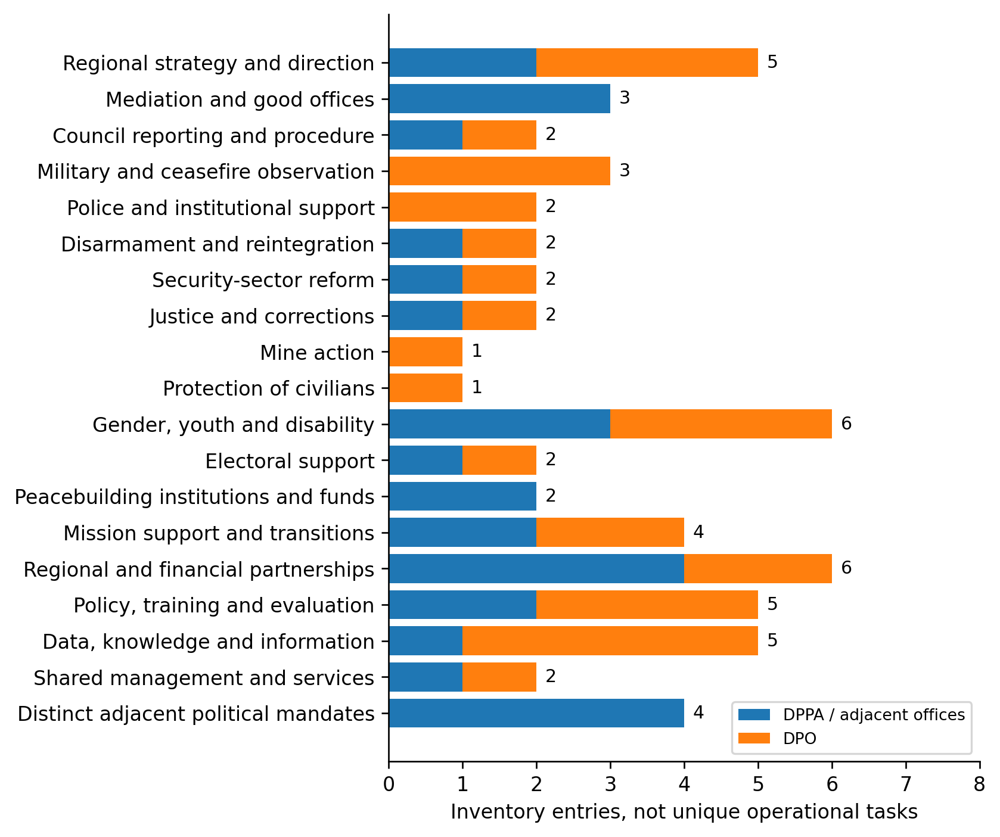

The scope includes peacekeeping, political and peacebuilding interfaces because those are where misleading claims of overlap frequently arise. Sanctions, decolonization, Palestine-related advocacy and counter-terrorism appear as adjacent mandates, not as interchangeable peacekeeping functions. Human-rights monitoring, child protection, conflict-related sexual violence, mission engineering and other enabling services are not each independently decomposed into complete workload populations. Their partial coverage must remain explicit. [1,2,20]

<!-- page -->
# 2. Similar responsibilities do not establish duplication

The 39 paired comparisons separate actual documentary relationships from hypotheses. Nine rows describe a shared structure or joint process; seven concern planned coordination. Another nine identify candidate overlap requiring operational evidence. Fourteen identify complementary roles or distinct mandates. The nine overlap candidates are a research queue, not nine proven redundancies. [1,2]

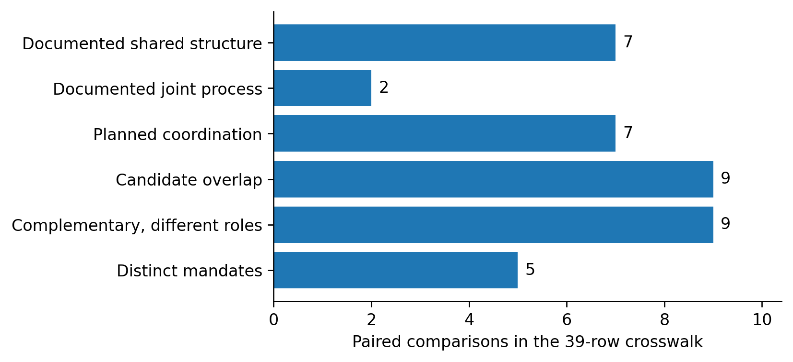

This distinction changes the counterfactual. Where a joint regional structure already exists, the question is not whether to merge two names on paper. It is whether residual, separately resourced preparation remains after the existing arrangement is accounted for. Where mandates are complementary, eliminating one activity may remove an essential capability rather than an unnecessary repetition.

A credible consolidation case must therefore identify the same or substitutable task, the relevant audience and period, separate resourcing, retained responsibilities and the actual change in delivery. Similar words, the same country, repeated statistics and common recipients can identify a question worth investigating. None establishes an avoidable expense. [1]

**Implication:** keep negative controls in the analysis. Council procedural support is not the same service as substantive mission reporting; political mediation is not military observation; independent sanctions safeguards are not redundant investigations. Removing these distinctions would make the screening appear more productive while making its conclusions less reliable. [1,2,9]

<!-- page -->
# 3. Status of the entire research programme

The project has completed several bounded research stages. It has not completed a system-wide efficiency evaluation. The appropriate status description is therefore a workstream matrix, not a single percentage whose denominator would be undefined. [1–19]

| Workstream | Completed evidence or artifact | Remaining substantive boundary |
|---|---|---|
| Departmental comparison | 59 function entries, 39 paired comparisons, 46 deliverables | Actual team ownership, effort and implementation |
| UN80 and organizational interfaces | 11 reviewed arrangements and five DPO allocation lines | Operational realization and cost allocation |
| Peacekeeping/support financing | Six detailed reconciliations; 11-entity maintenance register | Actual service and expenditure substitution |
| SPM proposals | Four addenda and 36 continuing mission budgets reconciled | Final 2027 resource decisions and implementation |
| ACABQ advice | Cluster I/II advice for 27 missions; general cross-cutting framework | Cluster III and SPM-wide advice not reconciled in the project |
| Public opportunity portfolio | 18 opportunity/control records; 14 parent and nine child research cases | Decision-specific operational and financial evidence |
| Council and activity census | Expanded document, transcript and source-discovery frames | Exhaustive field/training delivery denominator |
| Identity and reuse audit | Cross-version reconciliation and 14 report–briefing associations | Internal editorial dependence and separately funded repetition |
| Worked production pilots | UNOWAS–UNOCA and Cyprus support models | Owner review, live quality, added burden and substitution |
| Reference and review governance | Reference 13.0, V10 protocol, tabletop, owner-review package | Authentic case-local authorization; no automatic live start |

The review package's publication is not evidence that it has been sent, endorsed or implemented. Both pilot gates remain **BLOCKED_FOR_LIVE_USE**. Neither a successful software test nor an adopted research correction can change that institutional condition. [16–18]

**Practical reading:** the public-source research is usable now for scrutiny, prioritization and a bounded owner discussion. Findings that depend on actual working practices remain hypotheses until those practices are observed or documented by authorized owners.

<!-- page -->
# 4. Mission coverage: breadth is not uniform depth

The approved-maintenance register contains 11 financed entities: nine peacekeeping operations plus the UNSOH and UNSOS support offices. It is not an 11-operation census. UNTSO and UNMOGIP are addressed separately through regular-budget sources and are outside this July–June maintenance total. The paper therefore distinguishes institutional type, financing perimeter and depth of review. [2–4]

| Coverage category | Entities |
|---|---|
| Detailed request-to-approval reconciliation | MINUSCA, MONUSCO, UNIFIL, UNISFA, UNMISS and UNSOS |
| Headline maintenance baseline | MINURSO, UNDOF, UNFICYP, UNMIK and UNSOH |
| Separate regular-budget observer operations | UNTSO and UNMOGIP |

The six detailed cases account for **87.1% of the value of this 11-entity register**. That is financial-scope coverage, not 87.1% of peacekeeping functions, staff time or mission effectiveness. Cyprus has deeper reporting-pilot evidence despite remaining outside the six-case detailed budget reconciliation. [3,15]

<!-- page -->
# 5. Approved budgets versus requests

The six detailed cases reconcile $4,120.951 million in original SG maintenance requests to $4,028.188 million in GA-approved maintenance requirements. The comparison uses the same gross maintenance perimeter and the same July 2026–June 2027 period. It does not mix maintenance requests with appropriations that include corporate support shares. [3]

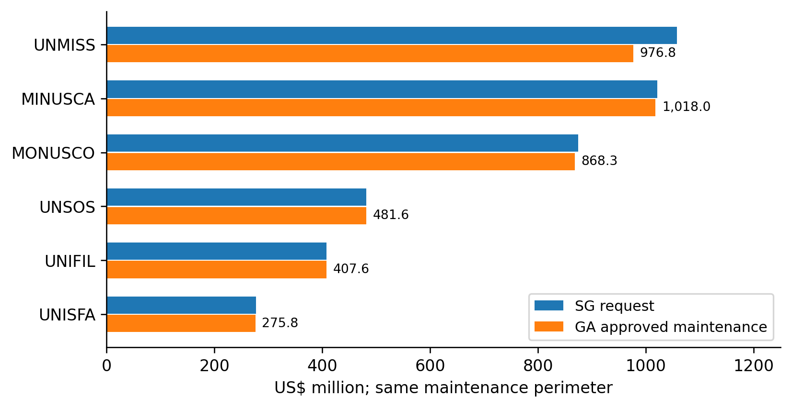

The combined approval is **2.25% below the request**. That is a documented resource decision. It does not establish that an eliminated line was duplicated, that a service remained equally effective, or that an additional future reduction is available. Implementation, capability and the receiving mission's costs require separate evidence. [3]

UNIFIL's request also reflects a transition period rather than a stable full-year operating model. UNMISS has specific adopted civilian establishment changes. Rebranding either transition or already approved post action as a fresh DPPA–DPO efficiency would count the same change twice. The correct baseline for later analysis is the approved and operationally applicable position, not the superseded request. [3]

<!-- page -->
# 6. One mission dominates the six-case budget variance

UNMISS accounts for approximately **87.1% of the $92.763 million request-to-approval reduction** across the six detailed cases. This concentration matters for interpreting the aggregate: it is not evidence of a common across-the-board departmental duplication problem. [3]

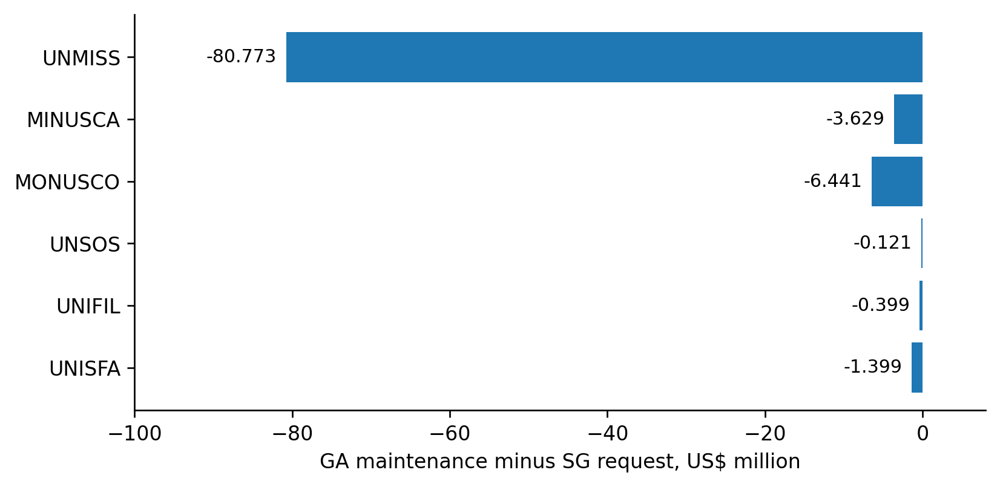

| Cost class, six cases | SG request, US$m | GA maintenance, US$m | Difference, US$m |
|---|---:|---:|---:|
| Military and police | 1,807.770 | 1,780.347 | −27.423 |
| Civilian personnel | 1,081.963 | 1,032.423 | −49.539 |
| Operational requirements | 1,231.218 | 1,215.417 | −15.801 |
| Total | 4,120.951 | 4,028.188 | −92.763 |

The adopted UNMISS action includes **91 civilian posts and positions, of which 53 are in Electoral Affairs**. Those are establishment decisions already recorded in the research baseline. They are not posts newly identified by this project for abolition. Subsequent validation must examine continuity of required outputs and actual implementation, not infer success from a smaller appropriation. [3]

<!-- page -->
# 7. Keep maintenance and corporate shares separate

The six GA resolutions' inclusive appropriations total **$4,442.119 million**. This combines $4,028.188 million of maintenance with $325.088 million in support-account shares, $48.282 million for the UN Logistics Base and $40.562 million for RSCE. The inclusive amount cannot be compared directly with the maintenance-only SG requests. [3]

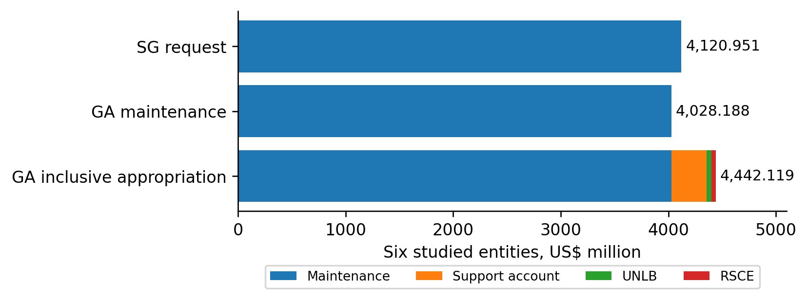

The same discipline applies to internal payments. A mission's charge for a shared service may also be revenue in the provider's account. Adding both sides overstates whole-of-UN spending; calling the receiving entity's revenue a saving confuses a transfer with a resource reduction.

Three records are therefore needed before a monetary efficiency claim: the baseline cost object, the service or obligation actually removed, and all costs retained or added elsewhere. A canceled requisition, reduced contract or released appropriation may provide evidence. A common budget label or a reduction in one client's charge does not. [4,5,9]

**Financial rule:** “not estimated” means the evidence is insufficient to quantify additional savings. It does not mean the true amount is zero, and it does not authorize filling the gap with a percentage of a gross mission budget.

<!-- page -->
# 8. The cost mix explains why capabilities matter

The approved maintenance figures combine uniformed personnel, civilian personnel and operational requirements in different proportions across the six cases. The category mix is a financing description, not a measure of service quality or avoidable overhead. [3]

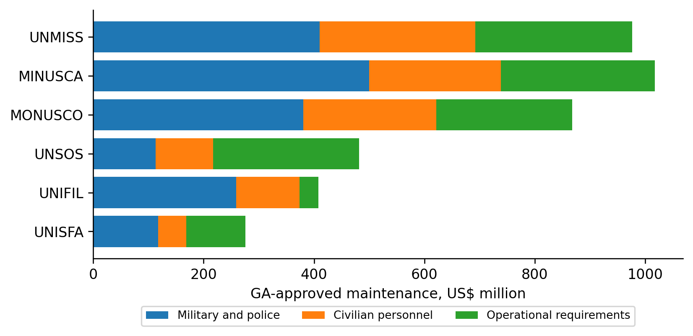

For military and police components, readiness, mobility, command arrangements and mandated task coverage can make similarly described capacity non-substitutable. For civilians, apparently related roles may carry different political, legal, protection or accountability duties. For operating requirements, an aviation or medical change can reduce one visible line while increasing risk or creating an obligation in another entity. [1–3,20]

These distinctions do not rule out efficiency. They identify the tests an efficiency claim must pass. Shared logistics, common procurement and coordinated administrative support are plausible investigation areas where geography, timing, technical specifications, funding and security requirements align. The project has not yet established that alignment at the transaction level across the entire portfolio. [3,9]

A sound decision should preserve the mission's required output and measure the full replacement process. It should not assume that the largest personnel or operating category contains the largest avoidable cost.

<!-- page -->
# 9. The SPM decline is mostly a closure effect

All four uploaded 2027 SPM addenda have been reconciled. The controlling proposal total is **$422.671 million net of staff assessment**: $419.412 million for 36 continuing missions and $3.259 million for their RSCE share. This supersedes the earlier provisional $423.545 million figure for proposal reconciliation. It is not a GA appropriation. [5]

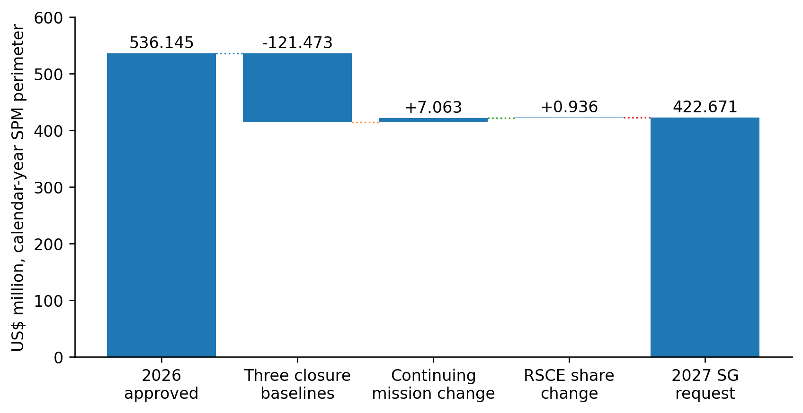

The aggregate falls from $536.145 million to $422.671 million, a $113.474 million reduction. But the three discontinued or discontinuing missions, UNAMI, UNTMIS and UNMHA, account for **$121.473 million** of the 2026 baseline. The continuing missions request **$7.063 million more**, and the RSCE share increases by **$0.936 million**. [5]

This decomposition is central to the project-wide conclusion. An aggregate decline can coexist with rising resources for the continuing portfolio. Neither observation by itself establishes duplication, performance improvement or a further reducible amount. Existing closures belong in the baseline; they cannot be relabeled as new savings generated by this research.

<!-- page -->
# 10. Continuing political missions require distinct tests

The nine continuing Cluster III missions reconcile from **$324.550 million approved for 2026** to **$325.354 million proposed for 2027**, an increase of $0.804 million. Their local research order is different from a ranking by mission size. [5,6,8]

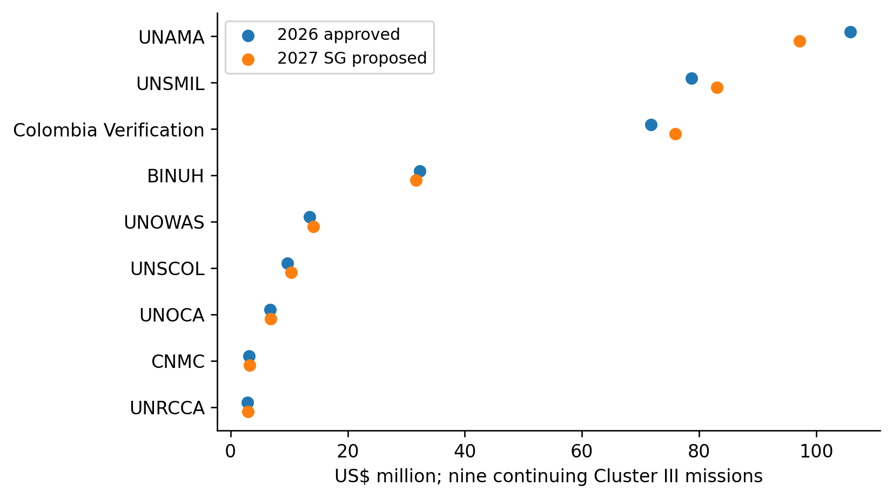

| Local sequence | Mission or office | Evidence needed next |
|---|---|---|
| 1–2 | BINUH; UNSCOL | Shared-support cost boundaries and physical asset receipt |
| 3–5 | UNAMA; UNSMIL; Colombia Verification | Staffing, facilities and aviation changes against retained outputs |
| 6–7 | UNOWAS; UNOCA | Owner assessment of the worked common-input proposal |
| 8–9 | CNMC; UNRCCA | Existing administrative arrangements and distinct political output needs |

The 36-mission staffing tables cover **2,684 personnel across all categories**. The separately reported **2,304 civilian posts, positions and volunteers** use a different perimeter. Their difference is not an unexplained surplus, and proposed establishment changes are not additional positions available for this project to remove. [5]

<!-- page -->
# 11. Advisory coverage is not complete budget authority

The retained ACABQ evidence supports mission-specific reconciliation for **27 of the 36 continuing SPMs**: 12 in Cluster I and 15 in Cluster II. Cluster I advice reduces the SG request by **$182,500**; Cluster II retains the proposed amount. General A/81/7 recommendations also supply a cross-cutting review framework. [6]

| Funding scope | SG 2027 proposal, US$m | Retained advisory result |
|---|---:|---|
| Cluster I, 12 missions | 56.3312 | 56.1487 |
| Cluster II, 15 missions | 37.7268 | 37.7268 |
| Cluster III, nine missions | 325.3539 | Not reconciled in project |
| RSCE SPM share | 3.2591 | Not reconciled in project |
| Complete envelope | 422.6710 | Not determined |

The paper does not infer that the missing advisory adjustments are zero. Nor does it assert that advisory reports are currently nonexistent merely because the project's status register retained an earlier “not yet issued” entry. A fresh official-index check was not sufficient to settle that publication status during this synthesis. The completed SG reconciliation and the incomplete ACABQ reconciliation must remain separate. [6]

<!-- page -->
# 12. Already priced efficiencies are the starting point

The SPM proposals contain **31 initiative estimates totaling $14.6925 million**. Of these, 19 Cluster III initiatives total $14.5604 million. They include staffing, compound, aviation, communications, procurement and service arrangements already incorporated in the requested resources. Their projected nature also matters: a budgeted estimate is not an audited realization. [5]

UNIFIL-to-UNSCOL transfers account for **$438,100** of projected avoided purchases and supplies. BINUH's use of UNSOH aviation includes **$1.4 million** in a projected efficiency, while wider support reimbursements sit elsewhere in the financing arrangements. The first requires evidence of assets received and purchases actually displaced; the second requires the provider's cost and receiving office's residual obligations. [5]

This is why the project ranks implementation verification ahead of attractive but unpriced merger claims. A failed or delayed prebudgeted change can create service risk and a financing shortfall. Confirming it is useful even when no new saving results. Conversely, successfully realizing an existing estimate does not create a second, additive project benefit. [5,8,9]

<!-- page -->
# 13. Headquarters funding: one allocation, not two

The five reviewed DPO support-account allocations sum to **$95.4641 million**. The same amount appears as the departmental “other assessed” estimate in the 2027 Section 5 proposal. These presentations describe the same financing slice; they must not be added together as separate resource pools. [2,4]

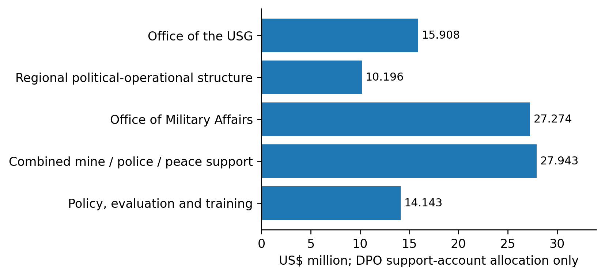

Two further boundaries prevent misleading administrative-savings claims. First, the **$10.196 million** regional line is the DPO support-account portion, not the whole DPPA–DPO regional structure. Second, the **$27.943 million** combined mine-action, police and peace-support line is not a standalone budget for one new office. [4]

On the DPPA side, the reviewed peacebuilding-office regular-budget total includes **$50 million in grants and contributions**. Those funds are not generic staffing or administrative overhead. A whole-office percentage cut would therefore mix institutional administration with programmatic financing and potentially cross incompatible authorities. [2]

The project has mapped these boundaries. It has not observed the staff allocation, client charging and residual work needed to attribute additional costs to a specific reorganizable function.

<!-- page -->
# 14. UN80: distinguish proposals, structures and outcomes

The 11-arrangement implementation register separates documented structures, planned coordination, existing services and a proposed service merger that the source does not characterize as a substantive UN80 change. This prevents the repeated description of one reform from becoming several independent “opportunities.” [7]

| Arrangement | Documentary position | What remains unverified |
|---|---|---|
| Regional political-operational structure | Continuation and further consolidation described | Actual implementation, residual work and allocations |
| Peacebuilding and Peace Support Office | Consolidation described; component approval boundaries retained | Operational integration and financing |
| Joint Gender Unit | Described as established in proposal | Full operational merger and work allocation |
| Policy coordination | Planned | Realized common production |
| Training coordination | Planned | Course-, audience- and cost-level substitution |
| Innovation coordination | Planned | Systems, users and equivalent capabilities |
| Partnerships coordination | Planned links | Identical requests and substitutable interfaces |
| Information-integrity coordination | Planned links | Governance, access and tool duplication |
| Joint disability plan | Documented joint process | Implementation and common indicators |
| Coordination and Shared Services Office | Existing joint reporting line | Service use and charge allocation |
| UNOAU internal service merger | 2027 proposal; not labeled a substantive UN80 adjustment | Operational realization and retained duties |

The training research also records the separate institutional integration baseline involving UNITAR and UNSSC. Its treatment in the project is “already authorized reform baseline,” not newly generated savings. This paper does not reopen that legal record or perform a new implementation audit. [7,13]

**Decision principle:** first establish what already exists or is already priced. Then identify any residual task that can change. New labels, co-location and reporting-line diagrams are not sufficient measures of implementation or efficiency.

<!-- page -->
# 15. Status across substantive peacekeeping capabilities

The table summarizes the evidence depth for the core capability families, not their importance. “Documented” means the project has a source-linked mandate/function basis; it does not mean operational effectiveness or redundancy has been measured. The family IDs are available in the companion functional-coverage register. [1,2]

| Capability family | Project position | Protected function / next evidence boundary |
|---|---|---|
| Military and ceasefire observation | Functions and selected financial boundaries documented | Military readiness and observation are not substitutes for diplomacy. No whole-capability workload audit. |
| Police and institutional support | Mandate and specialist-output comparisons | Keep police readiness, host-institution support and distinct qualifications. |
| Disarmament, demobilization and reintegration | Shared-office descriptions and selected mission/PBF interfaces | Match programmes, partners, recipients and funding before alleging duplicate delivery. |
| Security-sector reform | Documentary integration and complementary-role analysis | Preserve specialist advice, national context and accountability. |
| Justice and corrections | Function comparison and combined-office financing limits | Do not infer dispensable expertise from a shared structure. |
| Mine action | Distinct technical function and combined allocation identified | Operational safety and specialist requirements not independently audited. |
| Protection of civilians | Function inventory and selected training/evidence links | Civilian, military and police roles are mutually supporting, not automatically interchangeable. |
| Gender, youth and disability inclusion | Joint-unit and joint-plan documentation | Retain distinct protection, participation and accessibility duties. |
| Electoral support | Department/mission interfaces and adopted UNMISS post-action baseline | Already approved establishment actions are not fresh eliminations. |
| Peacebuilding institutions and funding | PBC/PBF functions, grant boundary and selected QIP comparisons | Keep separate fund governance, project identity and recipient controls. |

UN peacekeeping's public description emphasizes political processes, protection, rights, elections and the rule of law alongside security. The reviewed POC guidance likewise treats protection as a responsibility across civilian, police and military components. Shared administration must therefore be evaluated against retained mission capability, not merely fewer organizational entries. [20]

Human rights, child protection and conflict-related sexual violence are not fully decomposed into independent workload populations in the original 59-row inventory. Their absence as standalone rows is a coverage limit, not an efficiency conclusion.

<!-- page -->
# 16. Status across enabling and adjacent functions

The reporting pilots have advanced only part of the functional portfolio. The table makes that asymmetry explicit. A prototype in factual support should not promote unrelated military, logistics or grant functions to the same readiness stage. [1,7–9,14–18]

| Function family | Strongest completed stage | Unresolved test |
|---|---|---|
| Regional strategy and direction | Crosswalk, existing-structure analysis and selected UNOWAS–UNOCA pilot | Internal ownership, residual parallel preparation and actual authority |
| Mediation and good offices | Documentary comparison and Cyprus written-report pilot | Distinct political engagement and confidential contact requirements |
| Council reporting and procedure | Formal-record census, explicit references and product-specific support views | Editorial dependence, task effort and clearance; procedural services remain distinct |
| Mission support and transitions | Budget/asset/service interfaces and implementation checkpoints | Receipt, handover, contracts, residual services and safe continuity |
| Regional and financial partnerships | Joint-activity evidence and role-specific comparisons | Whether the same institution receives truly duplicate requests |
| Policy, training and evaluation | Named outputs, curricula/cohort controls and event evidence | Same-audience material identity, outcomes and genuinely shared purchased inputs |
| Data, knowledge and information | Source/version prototypes and software-governance hypotheses | Existing system equivalence, access, licenses and maintenance burden |
| Shared management and services | Cost-boundary mapping and high-priority service questions | Agreed service catalogue, client charging, post/task allocation and delegation |
| Distinct adjacent political mandates | Negative controls for sanctions, decolonization, Palestine and counter-terrorism interfaces | No case for substituting peacekeeping for separate mandates established |

A complete operating-model audit would additionally require systematic treatment of finance, human resources, procurement, supply chain, medical support, aviation, engineering, environmental management, safety, conduct and discipline, and information security. The present project reaches some of these through selected mission controls, but not through a uniform activity-based cost and outcome census. [3,9]

**Overall finding:** the evidence is broad enough to reject indiscriminate merger logic and to specify bounded tests. It is not broad enough to certify that every peacekeeping function has been assessed for operational duplication.

<!-- page -->
# 17. The frozen portfolio ranking remains a research order

The existing 14-parent ordering prioritizes documentary specificity, feasibility and risk. It is not a ranking of missions to abolish or expected dollar savings. This paper preserves every rank and treats later pilots as readiness evidence within their relevant cases. [8]

| Rank | ID | Investigation | Current next test |
|---:|---|---|---|
| 1 | C16 | Shared services | Mandatory service catalogue, client charging and retained delegated decisions |
| 2 | C07 | Cross-mission transitions | Handover, residual services and prebudgeted baseline |
| 3 | C01 | Regional desks | Actual product ownership, post/task allocation and reporting topology |
| 4 | C04 | Training administration | Comparable cohorts, calendar, vendors and qualifications |
| 5 | C09 | Regional partnerships | Owner review of the UNOWAS–UNOCA factual-support case |
| 6 | C02 | Political reporting | Owner review of distinct-report support and source updates |
| 7 | C05 | Knowledge management | Existing storage, access, licenses and maintenance equivalence |
| 8 | C12 | UNIFIL transition interface | Handover and safety; preserve the prebudgeted UNSCOL benefit |
| 9 | C19 | UNISFA translation and assets | GA-directed stewardship and utilization questions |
| 10 | C15 | UNMISS establishment implementation | Verify already approved changes and continuing outputs |
| 11 | C03 | Combined peace-support / mine / police structure | Specialist boundaries and actual integration |
| 12 | C08 | UNSOS and related service controls | Contractor recovery and support arrangements, not automatic savings |
| 13 | C13 | MINUSCA QIP / PBF interfaces | Project identity, recipients and separate fund governance |
| 14 | C11 | Information integrity | Governance and software footprint before pooling tools |

The nine Cluster III work packages are children of this hierarchy, not nine additional independent cost pools. Likewise, C09 and C02 describe aspects of the same UNOWAS–UNOCA pilot, and C05 enables its controls. Monetizing those entries separately would duplicate the proposed benefit before any benefit has been established. [8,14,18]

<!-- page -->
# 18. The census is systematic within defined source frames

The refreshed frame contains **134 SG report symbols, 413 distinct formal Council meeting IDs and 481 transcript variants**. The latest indexed report date is 12 October 2026 and the latest meeting date is 14 October. Formal records are not a denominator for informal consultations or all work used to prepare a Council appearance. [10]

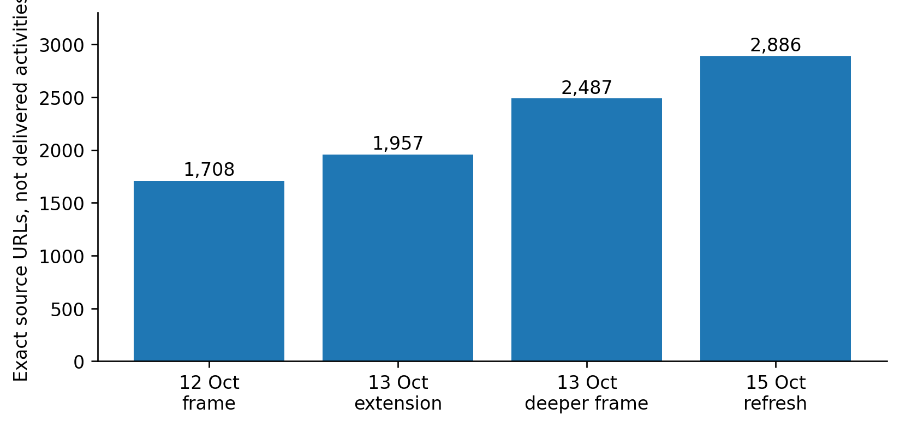

| Source unit | 2025 | 2026 through the retained cutoff | Interpretation |
|---|---:|---:|---|
| SG report symbols | 84 | 50 | Annual-index records, not workload hours |
| Formal meeting IDs | 255 | 158 | Distinct base identities |
| Transcript variants, both years | — | 481 total | Includes 68 resumptions, not 68 additional base meetings |

The partial 2026 period must not be compared with full-year 2025 as a productivity trend. The printed date/year anomaly for S/2026/513 remains flagged rather than silently corrected. [10]

The **2,886-URL** mission/department frame is a discovery population. It includes notices and pages that may represent advertisements, mirrors, retrospective programmes or multiple activities. It neither establishes 2,886 delivered events nor supplies the denominator needed to estimate the prevalence of duplicated field or training work.

<!-- page -->
# 19. Identity reconciliation is not an event census

Across 13 curated registers and views, 371 observations carried 130 local identifiers. The cross-version audit screened all 8,385 identifier pairs and adjudicated 191 candidate pairs. Five alias groups absorbed seven redundant identifiers, yielding 123 canonical evidence identities. These identities include different kinds of events, products and programme-level evidence. [11]

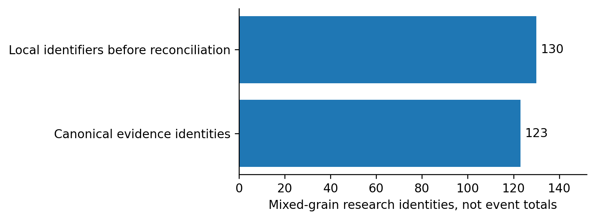

The audit preserves nonduplicates as well as aliases: parallel specialist courses can share a date and location without being the same course; successive cohorts remain distinct; one publication may describe several cohorts; and a workshop is not identical to the publication launched there. Without these controls, collection effort creates apparent operational volume and false opportunities for consolidation. [11]

The seven previously missing original transcripts were subsequently recovered in V7. The effective 14-link register now records **13 explicit agenda/presentation associations and one discussion-only association**. Recovery closes those retrieval gaps; it does not establish that each briefer relied on the associated report for every statement. [12]

Across 14 report-pair tests, six show explicit cross-mandate references, two refer to earlier reporting periods, and six lack an explicit paired-document reference in the extracted text. Absence of such a reference does not prove independent preparation, and its presence does not prove duplicate paid production. [11,12]

<!-- page -->
# 20. Training: share administration before erasing expertise

The 2027 programme tables describe different training scopes. Their activity-days are not course counts, participant counts, classroom bookings or vendor charges. The policy/evaluation/training subtotal contains a 312-day curriculum and trainer-support subset inside its 360-day total. Adding that subset again would overstate the planned activity. [13]

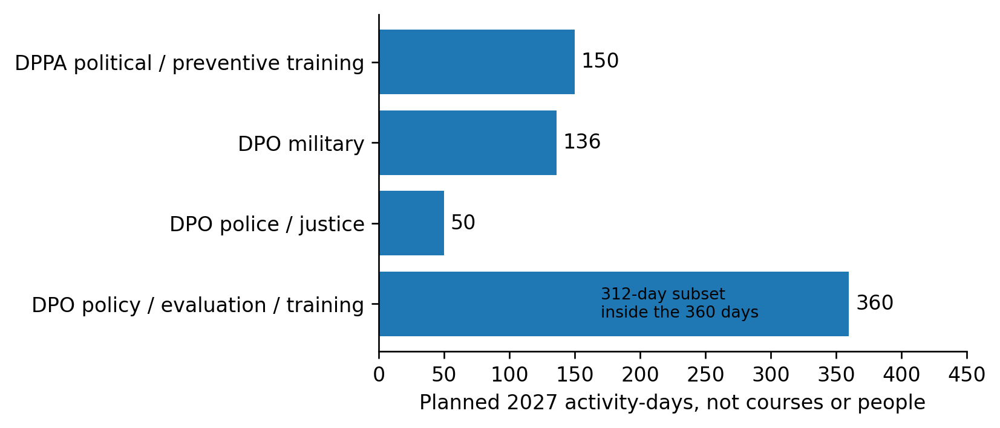

The best additional candidates concern eligible calendar metadata, enrollment administration, venue/vendor comparisons, reusable generic materials and evaluation definitions. Existing LCM and other reviewed training/review tools are baseline arrangements; the project does not support creating another portal merely because several providers teach peace-operations topics. [13]

Eight advertised 2026 courses have retained verification dispositions: **two elapsed schedules with unverified completion, one schedule spanning the cutoff and five future listings**. A related Korean programme has conflicting dates and cannot be silently equated with the ITS listing. No course completion is inferred from a date passing. The course watch is paused and has not been restarted for this paper. [11,18]

Retrospective evidence supports 20 of the 32 selected planned-output categories. The other 12 lack a matched retrospective example in that frame; that is not evidence of absent delivery or duplication. [10–13]

Technical instruction, safety and readiness outcomes require separate treatment. Aviation rescue, security screening, liaison, police, military, mediation and rights-related training are not interchangeable simply because they use similar administrative systems.

<!-- page -->
# 21. Two pilots test representation, not operational impact

The UNOWAS–UNOCA and Cyprus pilots convert selected public-source observations into product-specific support views. Together they cover 25 analytical components, 64 source observations and 61 fixed product obligations across 12 product identities. The obligations include both factual support and preservation of boundaries. [14–17]

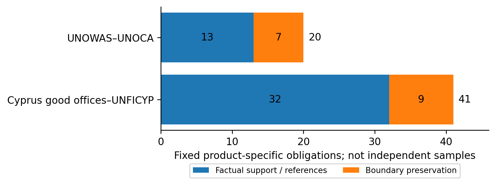

| Comparison | UNOWAS–UNOCA | Cyprus good offices–UNFICYP |
|---|---|---|
| Products reconstructed | Two reports and two briefings | Eight written reports across four cycles |
| Existing cooperation | Joint activities and explicit referrals | Joint committee support and companion reports |
| Control emphasis | Chronology, nesting and attributed updates | Definitions, stage, scope and authorship |
| What was not measured | Internal task effort, clearance and substitution | The same, plus no oral-briefing transfer test |

These are purposively selected, known cases. They are not randomized treatments, blind holdouts or independent workflow samples. Their value is narrower but concrete: the model can represent recurring facts while retaining the separate products and the differences that matter. [14,15]

The immediate operational question is whether the existing offices already maintain equivalent controls. If they do, adding a second register would add burden rather than efficiency. This remains an unresolved owner question, not a premise that the project may assume away. [17,18]

<!-- page -->
# 22. UNOWAS–UNOCA: one source packet, separate judgments

The worked cycle uses S/2025/187, S/PV.9890, S/2025/342 and S/PV.9931, supported by two official activity notices. Three core activities have nine selected appearances across the two reports and the April UNOWAS briefing. The June UNOCA briefing instead contains an explicit attributed reference to the earlier UNOWAS statement. [14]

| Selected component | UNOWAS report | UNOWAS briefing | UNOCA report | UNOCA briefing |
|---|---|---|---|---|
| Nigeria joint visit | Recorded | Recorded | Recorded | Not forced into this selected view |
| Governors’ Forum participation | Recorded | Recorded | Recorded | Not forced into this selected view |
| Dakar workshop | Recorded | Recorded | Recorded | Not forced into this selected view |

Separately, the June UNOCA briefing explicitly attributes the Niger withdrawal announcement to the earlier UNOWAS briefing. The source-component register governs each selected observation; later information is not inserted into an earlier product. [14]

A useful common record would retain the 27/28 January disagreement rather than vote for a “correct” start date; distinguish Forum duration from representatives' attendance; retain “more than 30”; distinguish adoption of a workplan from its implementation; and preserve the publication as a separate product rather than another workshop. [14]

The proposed operating model is correspondingly limited: a jointly usable factual record in existing approved storage, independently selected by each office, with separate analysis, deadlines and approvals. No mission is repeated for the test, and neither the CNMC legal function nor regional political judgment becomes a generic shared task.

**Finding:** nine appearances can be represented through three core identities. That does not demonstrate six eliminated preparation tasks, six avoided trips or any percentage reduction in staff work. Internal provenance and resourcing remain unknown. [14,18]

<!-- page -->
# 23. Cyprus: the strongest benefit is preserving differences

Both July 2025 reports print **€15.2 million** of 2024 Green Line trade, but they present different export comparators. The corresponding descriptions are not identical, and the sources do not reconcile their definitions or values. The correct shared record retains both attributed figures and withholds a harmonized ratio. [15,16]

| Project or statement | Required separation |
|---|---|
| Existing crossing enlargement | September planned start; early-December actual start; February event marking completion |
| Additional proposed crossings | Not established by completion of an existing crossing's enlargement |
| Cemetery programme | Completed initial initiative versus approximately 70-site mixed-stage expanded portfolio |
| Leaders' annex submissions | Party attribution, not Secretariat endorsement |
| Joint Contact Rooms | Information-exchange instances versus exchange of individuals in custody |

Reciprocal July 2026 referrals support complementary accounts: a committee workshop and detailed buffer-zone context belong to different analytical or operational scopes. The referrals are not independent corroboration of every fact, and they do not authorize replacing detailed operational duties with a political summary. [15]

The two AM11 corrections now adopted in reference 13.0 concern the project's own summaries. They are not findings that UN staff made those errors in the original reports. That distinction is essential when presenting the pilot for owner review. [16]

<!-- page -->
# 24. Reference quality: preserve the first pass

The public-source tabletop reviewed all 61 fixed obligations. The historical result remains **59 formulations supported unchanged and two held for amendment**. Reference 13.0 subsequently adopted the two source-checked corrections and rechecked their two affected assertions. The other 59 were not freshly rescored. [16]

AM11-01 preserves two actions: information exchanged in 202 instances and, separately, three individuals exchanged in custody. AM11-02 preserves the strict lifetime lower bound, **more than €1.7 million since 2019**, separately from approximately 67% of the €1.5 million 2023–2026 allocation. Neither permits a cross-unit total, cross-perimeter ratio or savings claim. [16]

This paper uses the adopted reference payload identified by its pinned SHA-256 hash. Original versions, earlier holds and post-amendment dispositions remain separate. The adoption is project research authority, not institutional clearance. Source review was assistant-conducted with prior exposure; software checks do not transform it into independent human adjudication.

**Scope of this synthesis:** figures and portfolio totals were recomputed from retained registers. The paper does not rerun the whole tabletop, reopen historical scoring or claim a new source-semantic review of every original page.

<!-- page -->
# 25. What the project needs from its owners

The consolidated package contains **16 evidence-gap questions**, not 16 demonstrated workflow defects. Ten concern initial owner review, four must be settled before any live shadow, and two belong to later substitution and cost-verification stages. [18]

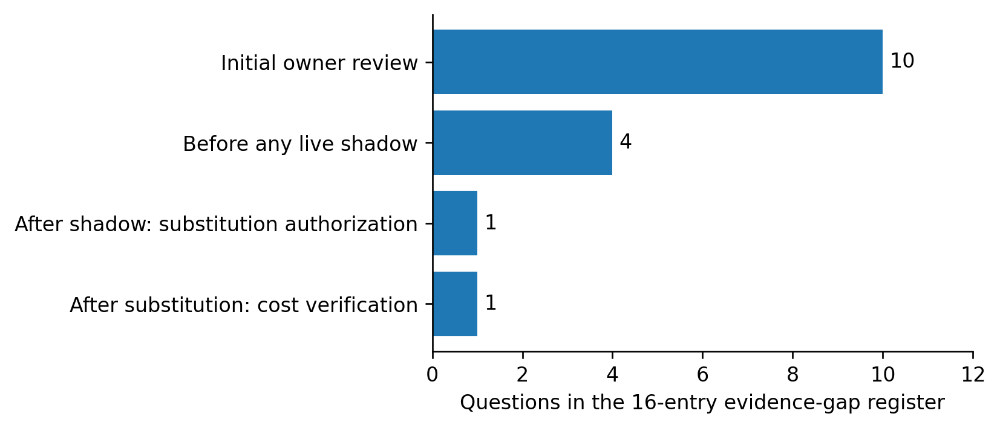

For UNOWAS–UNOCA, start with one sanitized source-to-clearance example showing the current shared record and handling of a disputed date or approved update. For Cyprus, start with one committee/project-to-report example showing definitions, implementation stages or attributed statements. The appropriate initial evidence is a limited process sketch and owner-approved control example, not an unrestricted collection of internal drafts. [18]

Owners should record one existing disposition independently for each case: retain the current process and close a redundant proposal; revise; decline/defer; or consider a bounded shadow subject to all V10 requirements. Silence is not permission, and a favorable technical result is not a substitute for a documented gap.

**User action:** no further input was needed for this white paper. To pursue operational validation, arrange an authorized discussion with the relevant existing workflow owners and decide what sanitized evidence may be shared. No request has been sent on the user's behalf. Live gates remain closed. [17,18]

<!-- page -->
# 26. What a valid shadow can and cannot show

The V10 protocol evaluates the same factual-support work slice under the same sources, language, scope and review requirements. It forbids comparing a complete SG report and its clearance with a short alternative fact sheet. Where the normal process's effort cannot be attributed reliably, the comparison is ineligible. [17]

| Symbol | Mutually exclusive effort bucket | Required treatment |
|---|---|---|
| B | Normal-specific work | Record actual scoped person-minutes |
| S | Shadow-specific work | Record corresponding alternative effort |
| C | Common input work | Count once in actual burden; show in both process descriptions |
| U | One-time setup and training | Retain visibly as implementation burden |
| E | Evaluation-only effort | Include assessment, failures and rework |

Normal process description = **B + C**. Shadow description = **S + C**. Actual trial burden = **B + S + C + U + E**. A comparable difference between the first two is a descriptive contrast, not work avoided: normal production still took place. Missing, estimated or non-comparable time prevents a complete-process contrast. [17]

Quality assessment must preserve source traceability, qualifications, update timing and all-enrolled failures. Factual-support and boundary-preservation duties remain separate strata. A faster materially incorrect output must not advance, and a later correction does not erase the first-pass failure.

| Stop trigger | Required response |
|---|---|
| Unauthorized transfer, access or approval change | Stop affected processing; use the existing incident/authority route |
| Required deadline at risk | Stop shadow dependence; preserve normal delivery |
| Misattribution, invented facts or false stage | Quarantine affected output; retain failure and correction effort |
| Unequal conditions or unreliable capture | Stop the comparison, not necessary normal production |
| Effort ceiling exceeded or permission withdrawn | Stop or close the pilot; no retroactive threshold increase |

Authentic owner permissions, approved storage, numerical effort ceilings, deadline buffers and a normal-process fallback are still required before a live start. The nine live instruments remain empty. [17]

<!-- page -->
# 27. Recommended project-wide decision

**Advance targeted evidence requests, not broad consolidation implementation.** The current portfolio is strongest at identifying the correct questions, preventing double counting and demonstrating two ways to represent shared facts. It has not established a financed, legally executable and operationally safe reduction. [1,8,17,18]

The next decision should keep three workstreams distinct. First, ask the reporting-pilot owners whether the proposed controls add anything to their actual process. Second, use the existing implementation queue to verify already priced asset, aviation, staffing and service changes where authorized evidence becomes available. Third, close the remaining coverage and advisory-status gaps only when they affect a decision, rather than expanding collections for their own sake.

| Outstanding issue | Present treatment | What would resolve it |
|---|---|---|
| Cluster III / SPM-wide advisory advice | Not reconciled in project; no zero imputation | Actual applicable advisory texts and source-linked extraction |
| SPM extrabudgetary perimeter | Mixed voluntary and cost-recovery items; historical discrepancies retained | Mission-level scope and accounting reconciliation |
| UNOWAS visit dates | 27/28 January starts retained by source | Authorized primary itinerary or documented correction |
| Cyprus export comparators | Both definitions/values retained; no shared ratio | Underlying statistical series and version/definition basis |
| Course completion | Retained unresolved dispositions; monitoring paused | Exact-cohort official delivery evidence under a new instruction |
| Existing owner systems | Equivalent-control question open | Sanitized workflow and control example |
| Work substitution | Not tested | Separately authorized replacement of one named step |
| Additional cash savings | Not estimated | Cancelable cost objects net of residual, operating and transition costs |

No single “project completion percentage” is defensible across these heterogeneous stages. The public-source synthesis, two prototypes, corrected research reference and owner-review package are complete within their declared scope. System-wide operating evidence, authority and financial substantiation are not. This is the status the decision-maker should use, rather than the latest completed version number. [16–19]

<!-- page -->
# Evidence and source notes

The quantitative results in this paper are recomputed from the repository snapshot **5c0fdb60eede8a5bb0e7ede9fd551ad4e3b65fb2**, the completed consolidated owner-review package. The current-reference pointer selects **UNPO-REF-13.0** for the fixed V8/V9 obligations; it does not govern unrelated mission-budget records. File-level SHA-256 hashes, figure values and the 19-family allocation of all 59 function IDs accompany this paper.

This is a project synthesis, not a fresh legal-status audit. Original budget and mandate citations are retained from the source registers. Some original links were inaccessible during this run. Their inaccessibility is not evidence that a document or activity does not exist. Contemporary public UN pages were used only to check broad functional context, not to replace private/project records or silently update the financing baseline.

[1] **Project methodology and functional inventory.** methodology.md; functional_inventory.csv; crosswalk.csv; deliverable_inventory.csv. The first corpus is the full submitted Section 3 and Section 5 proposals. [Repository methodology](https://github.com/LystadJS/UN-Peace-Operations-Efficiency/blob/5c0fdb60eede8a5bb0e7ede9fd551ad4e3b65fb2/docs/methodology.md).

[2] **Departmental mandate, deliverable and funding sources.** A/81/6 (Sect. 3) and A/81/6 (Sect. 5), source-linked in initial_findings.md, financial_guardrails.csv and evidence_links.csv. [Section 3](https://docs.un.org/en/A/81/6%20%28Sect.%203%29); [Section 5](https://docs.un.org/en/A/81/6%20%28Sect.%205%29).

[3] **Approved mission financing.** A/C.5/80/20, annex pp. 2–3, and A/RES/80/275, 276, 278, 282, 283 and 285. Registers: ga_mission_reconciliation.csv, ga_approved_all_missions.csv, ga_approved_resource_components.csv and ga_unmiss_abolishments.csv. [Approved-resource note](https://docs.un.org/en/A/C.5/80/20); [project reconciliation](https://github.com/LystadJS/UN-Peace-Operations-Efficiency/blob/5c0fdb60eede8a5bb0e7ede9fd551ad4e3b65fb2/docs/appropriation_spm_consolidation_audit.md). Later SPM reconciliation supersedes that document's early SPM-status section.

[4] **DPO support-account boundary.** A/80/631, p. 44; support_account_units.csv and cost_allocation_bridge.csv. [Original source](https://digitallibrary.un.org/nanna/record/4109170/files/A_80_631-EN.pdf?registerDownload=1&version=1&withMetadata=0&withWatermark=0).

[5] **2027 SPM proposals.** A/81/6 (Sect. 3)/Add.1–4. Chapeau Table 4, p. 32; detailed mission Tables 1–3 and cited staffing/financing paragraphs. Registers: spm_2027_mission_budget.csv, cluster_bridge.csv, embedded_efficiencies.csv and extrabudgetary ledgers, each with the spm_2027_ prefix. [Reconciled source account](https://github.com/LystadJS/UN-Peace-Operations-Efficiency/blob/5c0fdb60eede8a5bb0e7ede9fd551ad4e3b65fb2/docs/spm_2027_reconciliation.md).

[6] **ACABQ reconciliation.** A/81/7 and A/81/7/Add.2–3; acabq_2027_cluster_reconciliation.csv, report_status.csv and main_crosscutting_framework.csv. [Cluster III status and limits](https://github.com/LystadJS/UN-Peace-Operations-Efficiency/blob/5c0fdb60eede8a5bb0e7ede9fd551ad4e3b65fb2/docs/acabq_2027_clusterIII_review.md). Missing advice is described as unreconciled in this project, not asserted currently unpublished.

[7] **Organizational reform register.** un80_implementation_audit.csv and un80_register.csv. Proposal descriptions remain separate from implementation, approval and outcome. [Register](https://github.com/LystadJS/UN-Peace-Operations-Efficiency/blob/5c0fdb60eede8a5bb0e7ede9fd551ad4e3b65fb2/data/un80_implementation_audit.csv).

<!-- page -->
# Evidence and source notes, continued

[8] **Frozen ranking and hierarchy.** acabq_2027_ranked_consolidation.csv; consolidation_comprehensive_2027.csv; clusterIII_2027_research_priorities.csv. [Parent ranking](https://github.com/LystadJS/UN-Peace-Operations-Efficiency/blob/5c0fdb60eede8a5bb0e7ede9fd551ad4e3b65fb2/data/acabq_2027_ranked_consolidation.csv).

[9] **Public decision and financial controls.** public_opportunity_register.csv, public_release_gates.csv and public_finance_nodes/edges.csv. [Public framework](https://github.com/LystadJS/UN-Peace-Operations-Efficiency/blob/5c0fdb60eede8a5bb0e7ede9fd551ad4e3b65fb2/docs/public_only_decision_framework.md).

[10] **Formal-source frame, 15 October refresh.** census_v5/index_refresh_summary.json and index_refresh files; earlier exact-URL frame releases retained separately. [Summary](https://github.com/LystadJS/UN-Peace-Operations-Efficiency/blob/5c0fdb60eede8a5bb0e7ede9fd551ad4e3b65fb2/data/census_v5/index_refresh_summary.json).

[11] **Cross-version and reuse audit.** census_v6/audit_summary.json, canonical evidence register, course verification and report-pair tests. [Audit](https://github.com/LystadJS/UN-Peace-Operations-Efficiency/blob/5c0fdb60eede8a5bb0e7ede9fd551ad4e3b65fb2/docs/census_2025_2026_v6_audit.md). V7 supersedes the earlier seven-transcript retrieval gap, not other V6 results.

[12] **Transcript recovery.** census_v7/transcript_recovery.csv and report_briefing_links_effective.csv. [Recovery account](https://github.com/LystadJS/UN-Peace-Operations-Efficiency/blob/5c0fdb60eede8a5bb0e7ede9fd551ad4e3b65fb2/docs/census_2025_2026_v7_recovery.md). Watch-creation statements there are historical; later instructions keep it paused.

[13] **Training and retrospective category evidence.** public_deliverable_crosswalk_2027.csv; deliverable_training_comparison.csv; V3–V5 source and training registers. [2027 deliverable comparison](https://github.com/LystadJS/UN-Peace-Operations-Efficiency/blob/5c0fdb60eede8a5bb0e7ede9fd551ad4e3b65fb2/docs/public_deliverable_overlap_2027.md). Later census stages retain 20/32 retrospectively supported categories; the earlier 19/32 statement is historical.

[14] **UNOWAS–UNOCA pilot.** S/2025/187; S/PV.9890; S/2025/342; S/PV.9931 and two official notices, pinned in census_v8/pilot_design.json. [Assessment](https://github.com/LystadJS/UN-Peace-Operations-Efficiency/blob/5c0fdb60eede8a5bb0e7ede9fd551ad4e3b65fb2/docs/v8_shared_production_assessment.md).

[15] **Cyprus transfer test.** Eight originals across January/July 2025/2026, pinned in census_v9/reviewed_design.json. Selected sources include S/2025/447–448, S/2026/9 and S/2026/550–551. [Assessment](https://github.com/LystadJS/UN-Peace-Operations-Efficiency/blob/5c0fdb60eede8a5bb0e7ede9fd551ad4e3b65fb2/docs/v9_cyprus_transfer_assessment.md).

[16] **Adopted reference and history.** census_v13/research_reference.json; adoption_record.json; reference_lineage.csv; affected_recheck.csv; current_research_reference.json. [Adoption account](https://github.com/LystadJS/UN-Peace-Operations-Efficiency/blob/5c0fdb60eede8a5bb0e7ede9fd551ad4e3b65fb2/docs/v13_reference_adoption.md).

[17] **V10 owner-review and shadow protocol.** Fixed scope, quality strata, workload rules, activation conditions and stops. [Protocol](https://github.com/LystadJS/UN-Peace-Operations-Efficiency/blob/5c0fdb60eede8a5bb0e7ede9fd551ad4e3b65fb2/docs/v10_owner_review_shadow_protocol.md).

[18] **Consolidated owner-review package.** Memo and 16-entry evidence-gap register. [Decision memo](https://github.com/LystadJS/UN-Peace-Operations-Efficiency/blob/5c0fdb60eede8a5bb0e7ede9fd551ad4e3b65fb2/docs/consolidated_owner_review_decision_memo.md).

[19] **Source exceptions and preservation.** spm_2027_source_discrepancies.csv, quality_issues.csv and the version-specific manifests. These contain different classes of issue and are not pooled into an error-rate denominator.

[20] **Official functional context.** UN Peacekeeping, [What is peacekeeping?](https://peacekeeping.un.org/en/what-is-peacekeeping) and [Protection of civilians mandate](https://peacekeeping.un.org/en/protection-of-civilians-mandate), checked 15 October 2026. Used for broad remit and safeguards, not new budget values or a fresh operational census.
